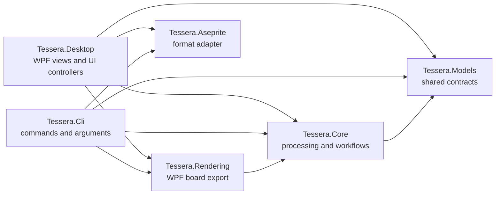

# Tessera architecture

The solution is arranged by responsibility. Desktop and CLI are two entry points for the same processing behavior.

## MVC mapping

- **Model** groups shared processing contracts in `Tessera.Models/Options`, `Results`, `Tiles` and `Enums`. `Tessera.Desktop/Models` groups app data by feature, including `Library`, `Workspace`, `History` and `Tiles`.
- **Controller** connects the UI to processing and storage. `Tessera.Desktop/Controllers/Editor` implements editor page behavior. The shell coordinates commands and workspace transitions with the controllers in `Library`, `Tools` and `Unreal`. `Tessera.Core/Workflows` coordinates shared processing steps. `Tessera.Cli/Commands` groups CLI commands by feature.
- **View** groups the shell and secondary windows under `Tessera.Desktop/Views/Screens`, navigable areas under `Views/Pages`, tool workspaces under `Views/Tools` and reusable WPF controls under `Views/Controls`. Each XAML file stays beside its code-behind. `Tessera.Rendering` owns the WPF-based board PNG renderer used by both entry points.

`MainWindow` hosts `LibraryPage` and `ImageEditorPage` in WPF frames and coordinates which screen is visible. `LibraryPage` hosts the opening screen and workspace browser. `ImageEditorPage` owns the current source and result, handles document transitions and wires the WPF controls to its components. Each editor creates its own component instances.

- `EditorHistory` owns history and source trays, branch edits, undo, macros and result drag-and-drop.
- `EditorPreview` owns zoom, comparison, lenses, viewport synchronization and live preview requests.
- `EditorTools` owns processing commands and tool settings. `EditorToolDock` owns open panels and floating tool windows. `EditorInfoTool` owns inspection, eyedropper and color replacement state.

`TileAtlasPage` owns tile selection, painting, repeated previews and pending atlas edits. It hands the composed result back to the image editor to save it into history. The window coordinates workspace imports, persistence and Unreal integration.

`Tessera.Core/Imaging` groups code by operation: `Color`, `Downscaling`, `Filters`, `Materials`, `Tiles`, `Export` and `Infrastructure`. `Tessera.Core/Alignment` contains grid alignment, and `Tessera.Core/Workflows` coordinates processing steps. These folders retain the `Tessera.Core.Imaging` namespace so moving a file does not change its processing API. `Tessera.Aseprite` keeps its independent `net8.0` decoder and exporter. The shared model and core never reference the desktop, CLI or rendering projects. The CLI never references the desktop project or compiles its source files through a linked `Compile` item.

`Tessera.Desktop/Services` contains update and uninstall code, progress support and the Unreal integration. Runtime artwork is grouped under `Tessera.Desktop/Assets`. Images used only for QA live under `docs/images`.

Existing `.tboard`, `.ttiles`, `.tmaps`, recipe and library formats retain their fields and operation IDs. The executable names remain `Tessera.exe` and `tessera.exe`. Project and namespace names changed; user data paths did not.

Source integrations that reference the former assemblies or namespaces need updated project references and `using` directives. Model enum type names now begin with `E`; serialized enum values and existing option property names remain the same. The public model contracts are under `Tessera.Models`; processing APIs are under `Tessera.Core.Imaging`, `Tessera.Core.Alignment` and `Tessera.Core.Workflows`.

## Verification

Build `Tessera.sln`, then run `Tessera.Aseprite.Tests`, `Tessera.Cli.Tests` and `Tessera.RegressionTests` with the flags used in `Build-Standalone.ps1`. The release script also publishes both entry points and checks the plugin package. WPF regression checks run programmatically; physical pointer and keyboard acceptance is separate.
