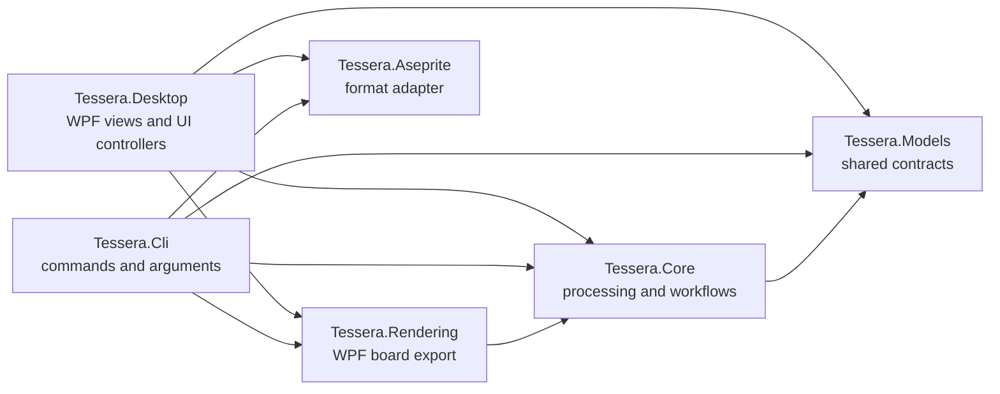

# Tessera architecture

The solution is arranged by responsibility. Desktop and CLI are two entry points for the same processing behavior.

## MVC mapping

- **Model:** `Tessera.Models` contains processing options, results and tile layouts. `Tessera.Desktop/Models` contains persisted workspace state and WPF-facing image assets.
- **Controller:** `Tessera.Desktop/Controllers` handles UI actions and connects the view to processing and storage. `Tessera.Core/Workflows` coordinates reusable processing steps. CLI commands are the second controller adapter.
- **View:** XAML, code-behind and visual helpers in `Tessera.Desktop/Views` render and collect input. `Tessera.Rendering` owns the WPF-based board PNG renderer used by both entry points.

`Tessera.Core/Imaging` and `Tessera.Core/Alignment` contain image processing. `Tessera.Aseprite` keeps its independent `net8.0` decoder and exporter. The shared model and core never reference the desktop, CLI or rendering projects. The CLI never references the desktop project or compiles its source files through a linked `Compile` item.

Existing `.tboard`, `.ttiles`, `.tmaps`, recipe and library formats retain their fields and operation IDs. The executable names remain `Tessera.exe` and `tessera.exe`. Project and namespace names changed; user data paths did not.

Source integrations that reference the former assemblies or namespaces need updated project references and `using` directives. The public model contracts are under `Tessera.Models`; processing APIs are under `Tessera.Core.Imaging`, `Tessera.Core.Alignment` and `Tessera.Core.Workflows`.

## Verification

Build `Tessera.sln`, then run `Tessera.Aseprite.Tests`, `Tessera.Cli.Tests` and `Tessera.RegressionTests` with the flags used in `Build-Standalone.ps1`. The release script also publishes both entry points and checks the plugin package. WPF regression checks run programmatically; physical pointer and keyboard acceptance is separate.
