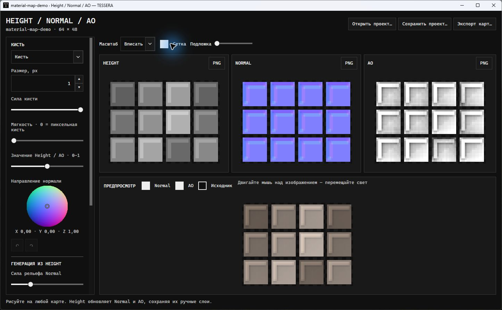
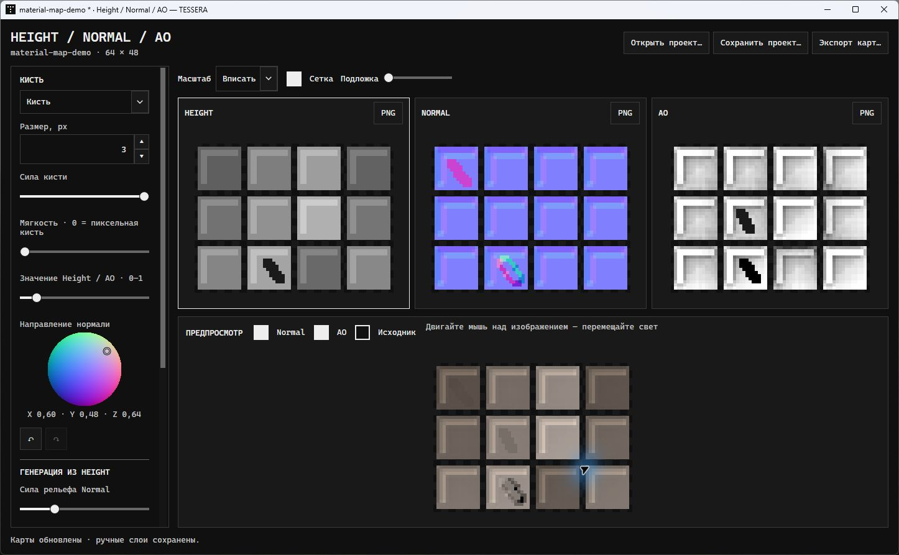
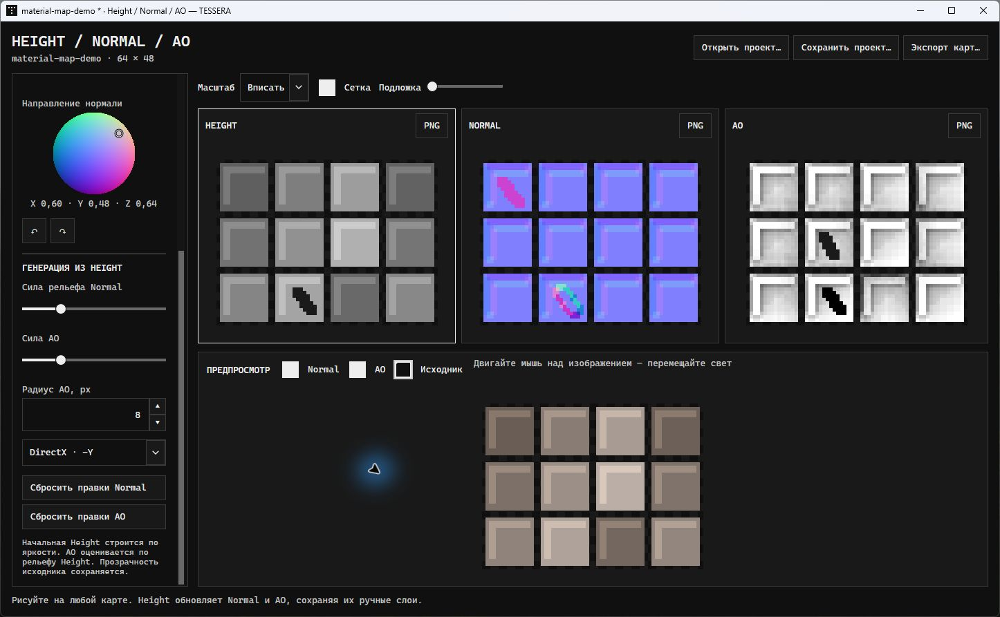
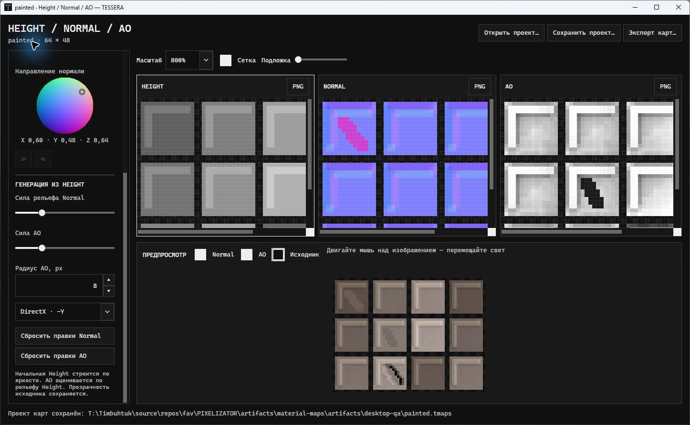
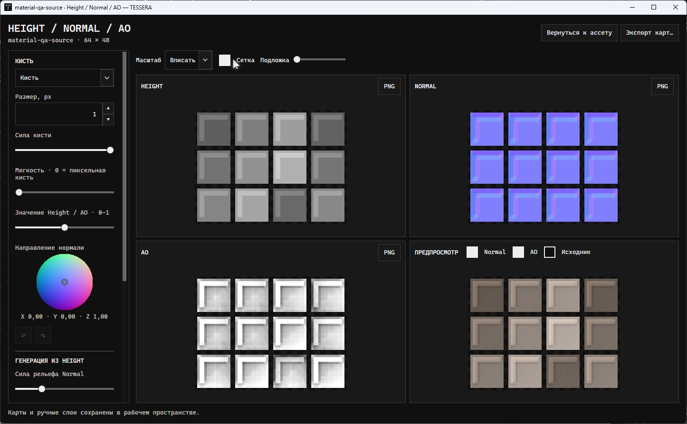
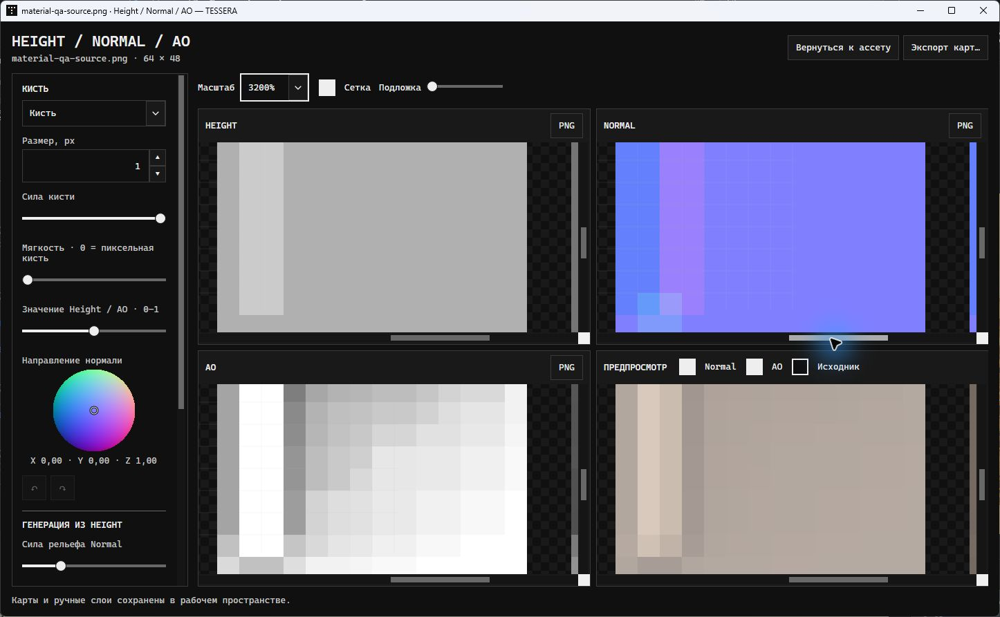
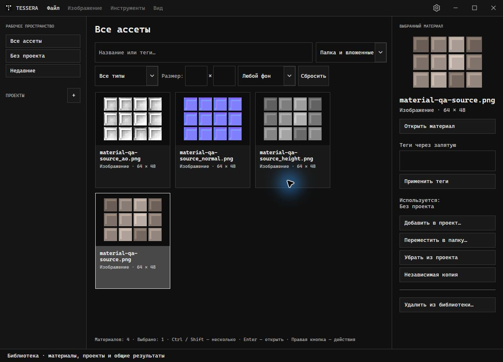

# Material maps verification — 2026-10-23

Branch: `codex/material-maps`, based on `origin/main` at `d13a6da`. The original dirty checkout is preserved; implementation and validation use `artifacts/material-maps`.

## Release integration — 2026-10-23

Release preparation uses `codex/release-material-maps-2026-10-23` in the same isolated checkout. It merges `main` at `81d8ad3`, retaining the released CLI/plugin packages and partial-alpha fixes. The two conflicts were in test argument registration and the next release notes; both material-map and alpha test routes remain registered, and the next notes describe the material-map editor.

A fresh restore from NuGet.org into an isolated package cache and a Release solution build passed with **0 warnings, 0 errors**. The integrated `--material-maps --alpha` run passed **13 checks**, including all seven material-map checks, source/result Tools dispatch, independent layers, PNG alpha, project roundtrips, compact layout and editor alpha/export/history checks. New rendered captures come from this integrated source; the physical desktop checks and screenshots below record the earlier feature-branch verification and were not repeated during this preparation. The actual release commit, complete CI and publication are verified separately by the release task.

## Implemented behavior

- Access from the active image asset editor through **Tools → Height / Normal / AO maps…**; source/result selection is respected. Each source/result retains its own open session.
- Automatic local generation at full source dimensions, with unchanged source alpha. All three maps have paint canvases beside each other; the lighting preview is below them.
- Direct Height/Normal/AO painting, square/soft brush, strength, size, grayscale value, normal hemisphere, eyedropper and eraser. Height recalculates both bases; Normal/AO manual layers survive independently.
- Independent and undoable Normal/AO layer reset, undo/redo, fit/explicit zoom, pixel grid and source overlay. Lighting can toggle Normal/AO, show the source and move with the mouse.
- Lossless portable `.tmaps` projects and individual/all-map PNG export. Source/library overwrite protection and unsaved-work guards. Russian/English UI and DirectX/OpenGL normal output.

## Passed

- Release solution build: **0 warnings, 0 errors**.
- WPF, processing invariants, navigation, workspace, localization and tool-improvement regression run: **77 PASS, 0 FAIL**. The seven material-map checks are included in `--ui` and thus the existing release pipeline.
- CLI: **67 passed, 0 failed**. Aseprite: **10 passed, 0 failed**.
- Bilingual next-release notes were added without changing historical entries. Release-note preparation fixtures and the WPF bundled-reader/history checks passed after the catalog change.
- Final focused material-map run after the Ctrl+S text-input handling adjustment: **12 PASS, 0 FAIL** (seven material-map checks plus five existing evaluator checks).
- Material cases: flat/gradient/cavity generation; 1-pixel axes, rectangular and >4096-pixel dimensions; 1024×1024 generation; normalized vectors and green-channel convention; transparent/partial alpha; independent layers after Height changes and resets; stroke interpolation, soft falloff and erasure; undo/redo; exact project roundtrip and invalid-file rejection.
- In-process WPF windows: Tools command availability and dispatch, session reuse, source/result isolation, all four canvases, Height-controller update, independent reset/undo, pending-slider save, project save, PNG dimensions/alpha and source overwrite rejection. Wide and 860×620 windows were rendered and visually inspected.
- On this machine, 1024×1024 initial generation plus a full Height regeneration took about **41 ms** in the final focused run; this is a local sample, not a cross-machine performance guarantee.

Commands and logs are under the isolated checkout's ignored `artifacts/`: `material-map-regression-desktop.log`, `material-map-cli.log`, `material-map-focused-final.log`, and `material-map-ui-*/wide.png` / `compact.png`.

## Limits and verification history

- A first sandboxed full run exposed missing checkbox tooltips, which were added. Its existing ICO cursor test also failed because cursor positioning was unavailable. The subsequent desktop-enabled full run passed all 77 checks without modifying that test.
- The first Computer Use attempt returned `Computer Use app approval timed out`. The follow-up desktop verification below completed this previously missing check.
- The 82 pre-existing modified/untracked files recorded in the primary checkout's preservation manifest retained their SHA-256 hashes.
- Height starts from luminance and AO is a height-field approximation. Atlases are processed as whole images; automatic cell/animation inference and 3D geometry baking are outside this implementation. Large-image limits depend on memory and the image codec; lighting preview sampling is capped at 512 pixels on its longest axis, while maps/export remain full-size.
- No merge into `main`, release or deployment is performed by this feature task.

## Follow-up: real desktop verification

Completed on 2026-10-23 using Computer Use against the built executable in this branch. The selected window was the separate **Height / Normal / AO — TESSERA** editor, opened through the real asset editor's **Tools** menu. A first parent-window capture cropped the owned tool; selecting the tool itself produced its complete window. This was a capture-target issue, not an application-layout defect.

- Imported the 64×48 pixel-art stone fixture through the standard file dialog, opened its asset and launched maps through Tools. All three maps generated automatically.
- Changed brush size to 3 pixels and selected a tilted normal on the hemisphere. Drew real drag strokes on Normal and AO, then Height. Both generated bases changed and both existing manual strokes remained visible.
- Clicked **Reset Normal edits**: only its manual stroke disappeared. Ctrl+Z restored it. Repeated for **Reset AO edits** and restored it independently.
- Moved the preview light with a mouse drag. Toggled Normal/AO contribution and source comparison. Selected 800% zoom, inspected the grid and scrollbars, then returned to fit with the keyboard.
- Selected the eyedropper and sampled a flat Normal pixel: the picker read **X=0, Y=0, Z=1**, without marking the project changed. Selected the eraser, removed part of the manual AO stroke to expose its generated base, and verified Ctrl+Z / Ctrl+Y / Ctrl+Z.
- Saved with Ctrl+S through the real Save dialog, reopened the `.tmaps` through **Open project…**, and saved again. The binary source/layers SHA-256 remained **62A09D97F7FF33BA719D985AEC19979C4EA0396DD5CBA3F4B3BC5619CC4A949B**. The saved independent layers contain **37 Normal pixels** and **30 AO pixels**.
- Exported all three PNGs through **Export maps…** and its Save dialog. Each output is **64×48**, with **0 alpha mismatches** against the imported source across all pixels.
- Alt+F4 with unsaved edits opened the save/discard/cancel guard. **Cancel** kept the window and strokes intact; Ctrl+S then saved successfully and cleared the unsaved marker.

Evidence files from these UI actions are in ignored `artifacts/desktop-qa/`: `painted.tmaps`, `before-resave.tmaps`, `exported_height.png`, `exported_normal.png`, `exported_ao.png`, `project-verification.json` and `png-verification.json`. The earlier 77/67/10 automated results remain valid; this follow-up changes documentation/screenshots only.

### Screenshots of the running tool

These are native window captures, not mockups or in-process WPF renders. The blue cursor highlight on some frames comes from Computer Use.

## Follow-up: workspace assets and synchronized 2×2 layout

Verified on Windows on 2026-10-24 in `codex/material-maps-workspace`, based on released `origin/main` at `6ea2561`. The earlier standalone-save workflow and screenshots above describe the original implementation; workspace integration now supersedes that workflow.

- Height/Normal occupy the top row, AO/lighting the bottom row. Shared headers keep the image viewports equal at normal and 860×620 minimum sizes. The sampled lighting image retains full source coordinates, so fit, explicit zoom, horizontal and vertical scrolling stay aligned with all three full-resolution maps.
- Completed edits autosave to the internal library after 800 ms of idle time. Return/close and the main **Save project / Ctrl+S** command flush pending generation settings. Three stable image assets appear alongside the source in its active project folder. Reopening Tools from the source or any map restores the editable layers; a processed result has its own session. Export PNG remains optional.
- Release solution build: **0 warnings, 0 errors**. Final full processing/WPF/navigation/workspace/localization/release-note/invariant run: **86 PASS, 0 FAIL**. Focused material-map run: **13 PASS, 0 FAIL**. CLI regression: **71 passed, 0 failed**.
- New acceptance coverage checks every scroll origin and actual WPF mouse-wheel event, fit/zoom, downsampled-preview coordinates, sibling placement without touching another project, stable asset IDs, idle/main-menu save, pending sliders, exact output PNG pixels, unchanged originals, locked-file failure/retry, and independent layers after restarting the library.
- Native Computer Use verification launched a separate build copy with a synthetic 64×48 pixel-art fixture and an isolated library. The real Tools menu restored the session after an application restart. At 3200%, a real AO wheel scroll set all four vertical scrollbars to **678.5**; dragging Normal's horizontal thumb set all four horizontal scrollbars to **1029.2814207650274**. A real AO stroke, **Return to asset** and main-window **Ctrl+S** completed without a Save dialog. The stored library contains **4 assets, 1 map session and 4 painted AO pixels**.
- Native wheel testing initially exposed stale offset reads during WPF layout, despite the initial programmatic-scroll checks passing. Synchronization now reads offsets after the layout pass; a wheel-event regression case and the repeated native check both pass. An earlier generated-record overwrite failure was also fixed and covered by repeated saves. No merge or release is performed by this follow-up.

Logs and test libraries are under ignored `artifacts/`: `material-workspace-build-desktop.log`, `material-workspace-focused.log`, `material-workspace-regression-final.log`, `material-workspace-native-data.json` and `material-layout-preview/`.

## Combined macro/history acceptance

On 2026-10-24 the workspace branch was combined with history/macros. Native Windows input again verified synchronized 3200% wheel/scrollbar movement, an AO stroke, return without a file dialog, main-window Ctrl+S and reopening the same painted session from a generated map. Opening the shared source from the second project's folder now adds the existing maps there without duplicating assets or sessions. A regression also covers reuse of an already open window and preserves map folders changed manually in the first project. The other project is not populated until its source is opened with the map tool.

See [combined acceptance](QA_HISTORY_MACROS_2026-10-24.md) for native evidence and the distinction from earlier standalone checks.
