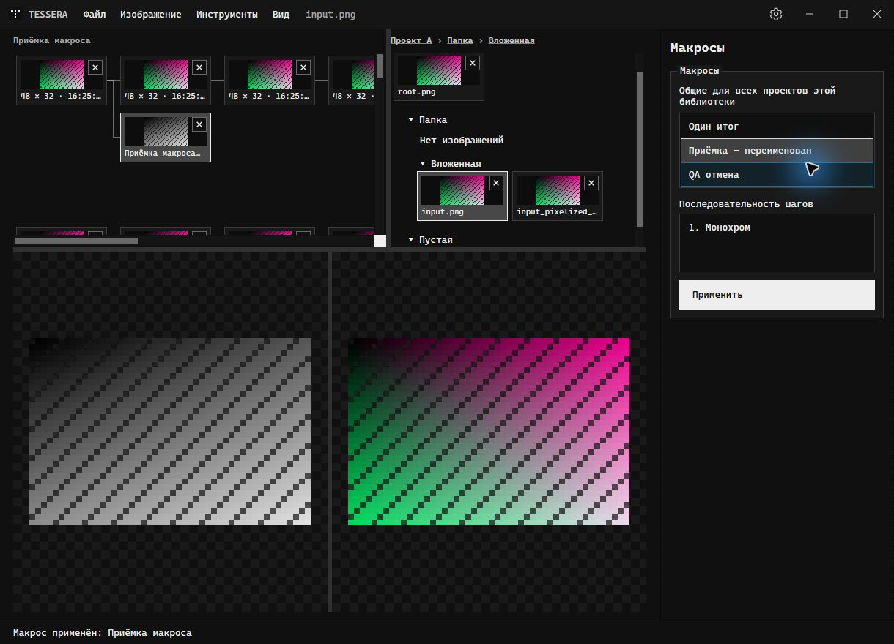
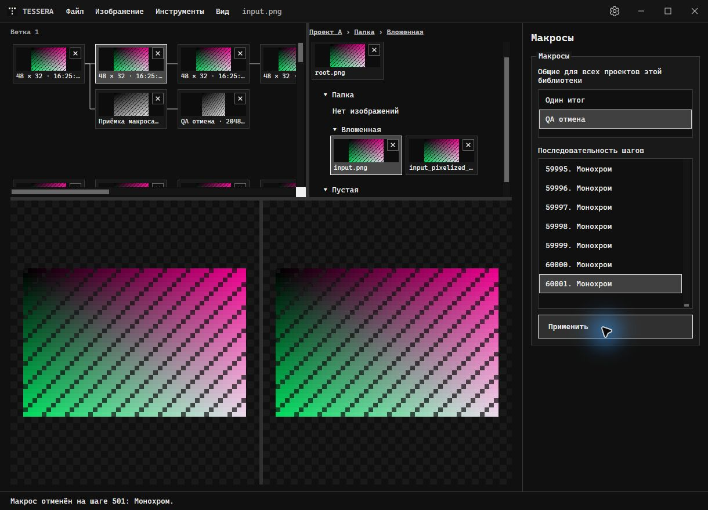
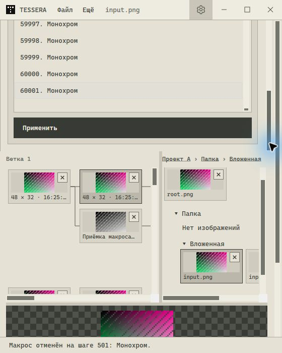
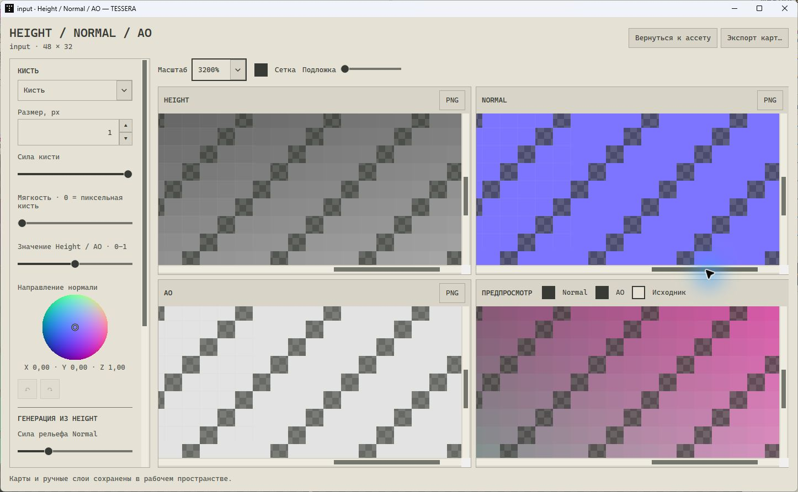
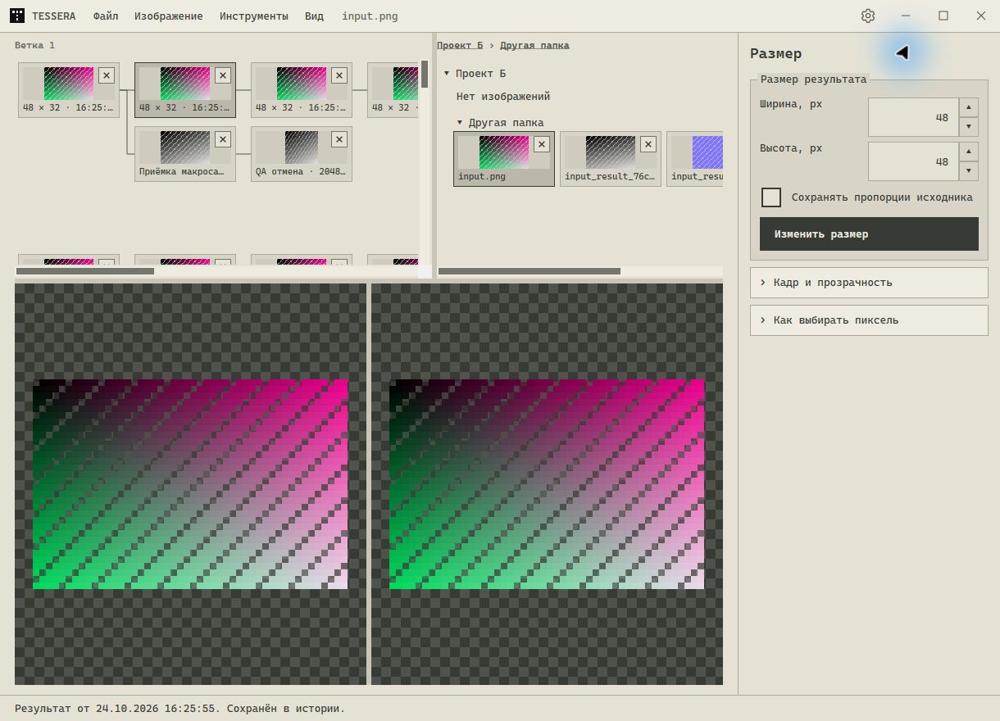

# Приёмка реворка лент и макросов · 2026-10-24

Реализация сделана в изолированном checkout `artifacts/history-branches-macros`, ветка `codex/history-branches-macros`. Основная рабочая папка с параллельными изменениями не использовалась для правок.

## Подтверждено

### Завершение настоящей приёмки и объединение карт

После прямого поручения пользователя продолжить приёмку выполнен настоящий ввод мышью и клавиатурой в отдельной копии сборки с синтетической библиотекой. Предыдущая остановка Escape ниже относится к более раннему этапу.

- Проверены вертикальная/горизонтальная прокрутка, оба разделителя, двойной щелчок, перестановка ветки и перетаскивание результата в независимый исходник, ПКМ и Shift+F10, выбор стрелками.
- Создан, применён, переименован и удалён макрос через интерфейс. Применение добавило ровно одну итоговую карточку с правильным родителем; удаление определения сохранило результат.
- Длинный макрос из 60 001 шага остановлен кнопкой на шаге 307 и настоящим Esc на шаге 501. В обоих случаях число файлов результатов осталось 116. Более ранний запуск из 301 шага успел завершиться и не считается проверкой отмены.
- После перезапуска восстановлены высота лент 300 px и их соотношение ширины. Проверены окно 560×700, доступность кнопок/предпросмотров через прокрутку, тёмная и светлая темы, прокрутка длинного списка до шага 60 001.
- Найденные настоящим вводом дефекты исправлены: горизонтальный разделитель растянут на всю ширину, скрытое при старте поле предпросмотра не сбрасывает высоту лент, Shift+F10 распознаётся как системная клавиша, список шагов принимает фокус и прокрутку. Добавлены проверки сохранения высоты и ширины разделителя.
- В объединённой сборке проверены сетка карт 2×2, общая прокрутка колёсиком/ползунком при 3200%, рисование AO, возврат без диалога, Ctrl+S, повторное открытие через созданный ассет с сохранённым ручным слоем.
- Общий исходник открыт из «Проект Б / Другая папка»: прежние три карты добавились рядом с ним, сохранив одну сессию и те же ID. Автоматизированная проверка дополнительно покрывает повторное использование уже открытого окна, повторное открытие и сохранение вручную перемещённой карты в первом проекте.

Настоящая приёмка макросов закрыта. Подробности программных прогонов и прежнего состояния ниже сохранены как история; окончательные CI и публикация проверяются по точному объединённому SHA.

Локальный полный прогон объединённого кода: **92 PASS, 0 FAIL** (`--release-notes --tool-improvements --history-macros --navigation --workspace --localization --ui --invariants`), дополнительно **75/75 CLI**, **10/10 Aseprite** и проверки подготовки патчноутов. Release-сборка: **0 предупреждений, 0 ошибок**. Логи: `artifacts/combined-regression.log`, `combined-cli.log`, `combined-aseprite.log`, `combined-notes-checks.log`, `combined-build.log`. Пакеты GitHub повторно проверяются после CI.











- Release-сборка решения: 0 предупреждений, 0 ошибок.
- `PixelArtAlignment.Tests --history-macros`: все проверки прошли. Итеративное дерево из 30 000 результатов; ветвление, перенос поддерева, независимость происхождения, циклы/отсутствующие родители, удаление предков, точные размеры/alpha, неполная старая история, неизменность исходников, независимый исходник, макрос из макроса, переименование/удаление определения.
- WPF в этом наборе: общий разделитель через события Thumb, две оси прокрутки, сохранение реальной позиции после закрытия/нового окна, компактная/развёрнутая раскладка, вложенные и пустые папки, разные привязки общего ассета в двух проектах, одна итоговая карточка, правильный родитель, видимость нового результата, минимальное окно, рендеры тёмной/светлой тем.
- В истории из 80 результатов создано 7 контейнеров; в модельном каталоге из 20 000 исходников — 20 контейнеров. Изображения для всех модельных исходников не записывались на диск; проверялась виртуализация элементов интерфейса.
- `Pixelizator.Cli.Tests`: 75 passed, 0 failed. Включает сравнение общего исполнителя с обычными процессорами, автоопределение, точные размеры, валидацию, номер ошибочного/отменённого шага, владение Bitmap, запрет частичного вывода и правила CLI.
- Скилл Tessera 1.2.0: исходный и установленный запускатели прошли по 17/17 интеграционных сценариев, включая реальный список и применение макроса; проверены 21 точка справки. Два ZIP и контрольные суммы пересобраны. Подробные локальные отчёты: `artifacts/cli-macro-handoff.md`, `artifacts/skill-macro-handoff.md`, `artifacts/chatgpt-plugin/`.
- RU/EN каталог прошёл проверку плейсхолдеров в расширенном прогоне. `git diff --check` чистый.

## Полный Windows CI и проверенные пакеты

Полный прогон после исправлений подтверждён [Windows CI run 40098407283](https://github.com/Timbuhtuk/TESSERA/actions/runs/40098407283) для точного head **`9ffb72bd878c23298ba984e4393d6b52398a6a18`**: **198 PASS, 0 FAIL**, сборка без предупреждений и ошибок. Прошли `--history-macros`, полные `--ui` и `--workspace`, остальные обязательные наборы, 75 проверок CLI и 17 сценариев plugin/skill. Найденные при разработке ошибки записи метаданных/выбора соседнего исходника и устаревшие ожидания плоской ленты не воспроизвелись в этом окончательном прогоне. Задание публичной публикации пропущено для PR.

`Build-Standalone.ps1` включает новый набор вместе с остальными регрессиями. [Draft PR #12](https://github.com/Timbuhtuk/TESSERA/pull/12) содержит реализацию и подготовку CI. Скачаны и проверены два артефакта этого run:

- [release-files, кандидат 1.0.52](https://github.com/Timbuhtuk/TESSERA/actions/runs/40098407283/artifacts/12562340666), 212 374 760 байт; SHA-256 `8fb713214ee9c7b173a73c42d3c005cbb9dc2dd738c9432a791777deff207812`.
- [windows-check-evidence](https://github.com/Timbuhtuk/TESSERA/actions/runs/40098407283/artifacts/12561837711), 3 099 267 байт; SHA-256 `a94333d5a00801e9cc1f7a649796b9b0b210e002a436c3db27219828e1f1402b`.

Хеши внешних ZIP совпали с метаданными Actions. Все пять хешей ниже вычислены по фактически скачанным файлам и совпали с `SHA256SUMS.txt` кандидата:

```text
947152e688ccbfaaac8122138892af2b0b24f5bdd261989f521ba9f5b76cf11f  Tessera.exe
32a4ad38e381ff1b9769b8d48fa2503c922f063eba070cee3ea5c9b2fd7af519  Tessera-win-x64.zip
d81160c486e0cf7fb4d12862640260c31808ea28e1f5776fd5884cbc0997ff65  Tessera-cli-win-x64.zip
dcfb27d521c996ee6655c6820a95b64ac1b2816e01477bad83b1f9d3c61a78ea  Tessera-chatgpt-plugin.zip
a9493ee259d11f50b6455f1229e82570d12acaf696d7cb5c8dc1402acdf4f142  Tessera-skill.zip
```

Оба EXE содержат одинаковую сборку `PixelArtWorkflows.dll` (SHA-256 `ce1f14f146d8ddd44c67ec937690509146faea6c0b268fab5168b5ae596239fe`) и зависимости процессоров. EXE в desktop ZIP совпадает с отдельным EXE; лицензии шрифтов присутствуют. Содержимое plugin/skill 1.2.0, включая запускатель и справочник макросов, совпало с исходниками. Патчноуты RU/EN, встроенные в фактический desktop EXE, совпали с `ReleaseNotes.json`; история предыдущих версий сохранена. На скачанном standalone CLI повторно прошли **17/17** сценариев plugin, включая 21 точку справки и реальный `macro list/apply`. Desktop EXE для этих проверок не запускался. Рендеры тёмной/светлой тем из CI просмотрены отдельно от приёмки настоящего ввода.

Подробные пути и отчёты: `artifacts/devops-history-macros-handoff.md`, `artifacts/devops-history-final-audit.json`, `artifacts/devops-history-ci.log`, `artifacts/devops-downloaded-plugin-checks.log` и `artifacts/devops-candidate-1.0.52/`. Кандидат 1.0.52 — пакет Actions, публичный тег/релиз v1.0.52 не создавался. Артефакты Actions хранятся до 2026-11-07; локальные скачанные копии сохранены.

Этот отчёт дополнен после проверенного SHA; сопровождающий коммит меняет только этот Markdown-файл. Указанный run подтверждает код `9ffb72bd878c23298ba984e4393d6b52398a6a18`, а не выполнение проверок на SHA последующего документационного коммита. Подтверждённые CI и пакеты не закрывают условие настоящего Windows-ввода.

## История условий до возобновления приёмки

1. Настоящий Windows-ввод проверен только частично: тестовая сборка открылась, проект и исходник были открыты мышью. Полная проверка прокрутки, разделителей, двойного щелчка, drag-and-drop, ПКМ/клавиатуры, полного создания/изменения макроса, отмены, минимального окна и тем не завершена. Computer Use остановлен физическим Escape пользователя; дальнейший ввод прекращён. Программные WPF-события и рендеры не считаются завершением этой приёмки.
2. Установленный скилл проверялся с CLI из `artifacts/history-branches-macros/artifacts/chatgpt-plugin/cli/tessera.exe`. Перед удалением checkout путь в `%LOCALAPPDATA%/Tessera/chatgpt-cli.json` необходимо переключить на окончательную опубликованную сборку. Загрузка новых инструкций в свежем чате не наблюдалась.

На том этапе PR оставался draft; это историческое состояние до прямого поручения пользователя возобновить приёмку и объединить обе ветки. Её результаты приведены в начале отчёта.

Старые результаты обработки не пересчитываются. Миграция меняет только метаданные, необходимые для сохранения однозначного рецепта перед удалением родителя.
